# Smart DryerNet

**Open, low-cost monitoring for grain dryers, elevators and storage towers — built on ESP32 and Raspberry Pi 5.**

A one-person farm-tech project from Latvia by Āris · Instagram [@kombainiera_dzive](https://www.instagram.com/kombainiera_dzive/)

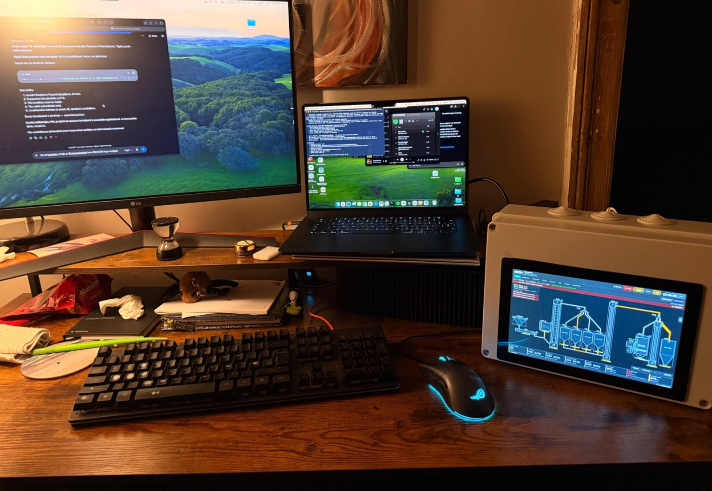

---

## Why

Small and mid-size grain farms run their dryers, elevators and towers from separate relay panels.
Nobody sees the whole flow at once, problems at night (overheated burner air, a stopped elevator,
an overfilled bin) are noticed late, and tonnes, moisture and drying costs are written on paper — if at all.
Commercial SCADA systems are too expensive for sites like these.

Smart DryerNet puts the whole plant on one touch screen, live.

## What it does

| | |
|---|---|
| **Live plant map** | Grain routes, tower levels, dryer mode, temperatures, elevator speed and flow in t/h |
| **Alarms** | Overheating, stopped elevator, full bin, lost sensor — on the panel, office TV and phone |
| **On-site calibration** | Multi-point calibration of every sensor from the touch screen |
| **Reports** | Water removed, tonnes per day, shift notes, 14-day history, CSV / PDF export |
| **Roles** | PIN-protected viewer / user / master / full-access roles |

> **Monitoring only.** Smart DryerNet reads sensors and never switches machines — the existing control stays in charge.

## How it works

```
 Sensors                ESP32 nodes               SDN Connect                 Screens
 ───────                ───────────               ───────────                 ───────
 inductive RPM   ──┐    dryer node        ──┐     Raspberry Pi 5        ──┐   10.1" touch panel
 temp / humidity   ├──▶ elevator node       ├──▶  + Touch Display 2       ├─▶ office TV (read-only)
 DS18B20, HX711    │    tower node          │     Python server, MQTT     │   phone / laptop browser
 4–20 mA, JSN-SR04T│    Petkus cleaner node │     alarms, history,        │
 current clamps  ──┘    (Wi-Fi + MQTT, OTA)─┘     nightly backups       ──┘
```

**SDN Dev** (desktop) is a drag-and-drop plant designer with 140+ ready parts — intake pits, elevators,
conveyors, towers, dryers, ESP32 nodes — and a simulator. A plant is drawn once and exported to the Pi.

## Screenshots

| Live plant map | Today view on the panel |
|---|---|
| 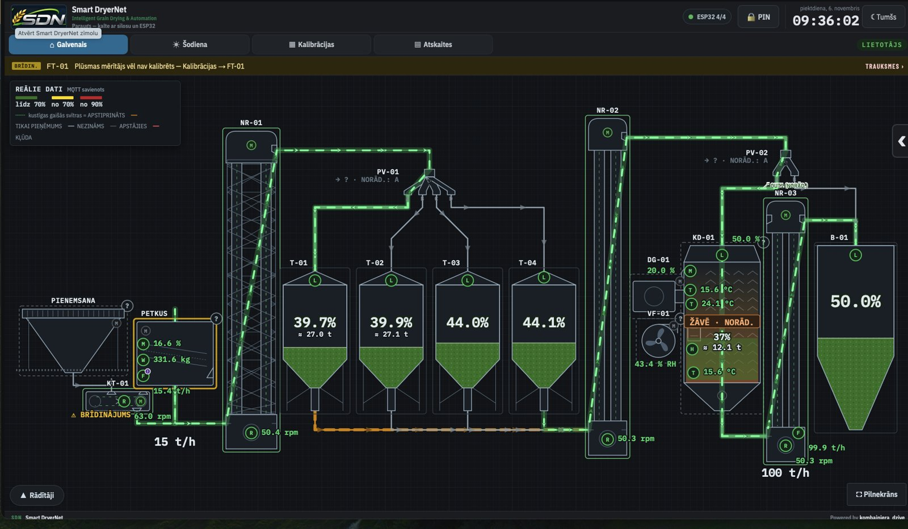 | 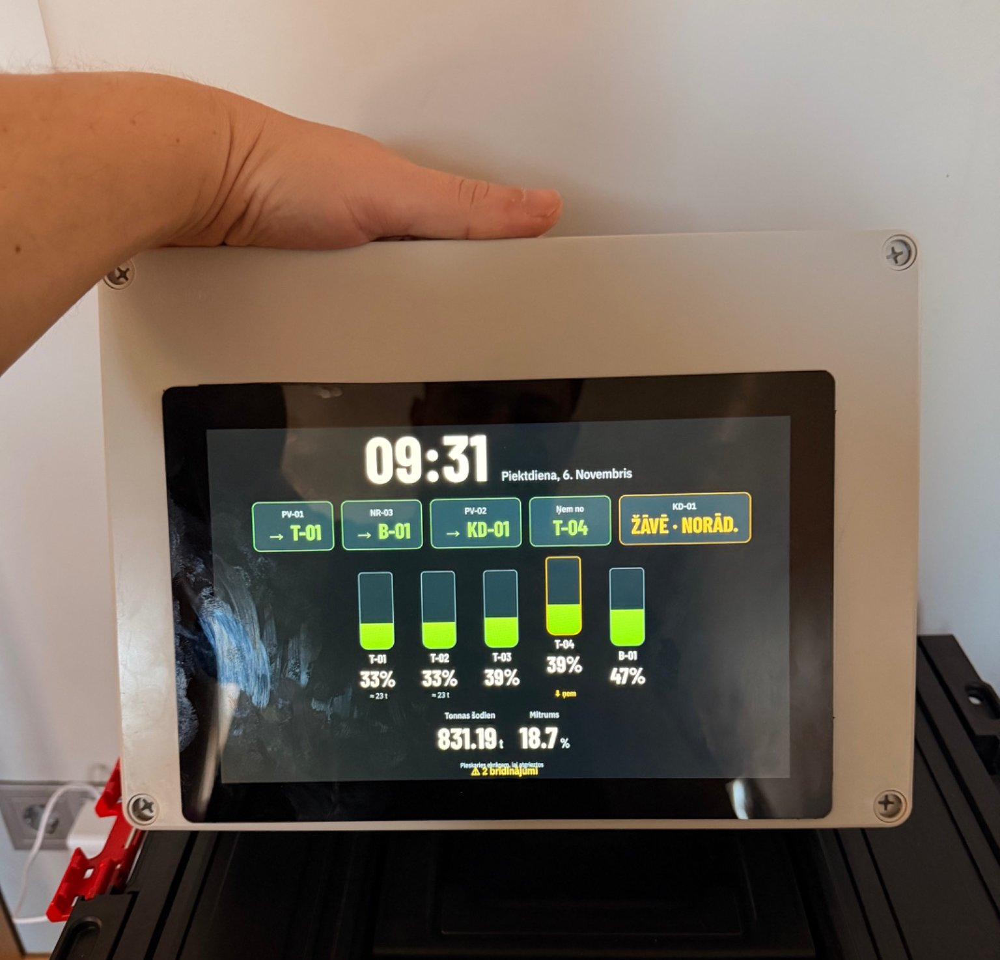 |

| Calibration | Dryer and shift report |
|---|---|
| 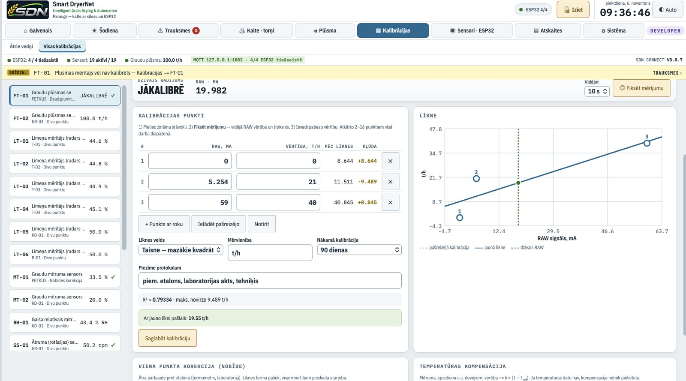 | 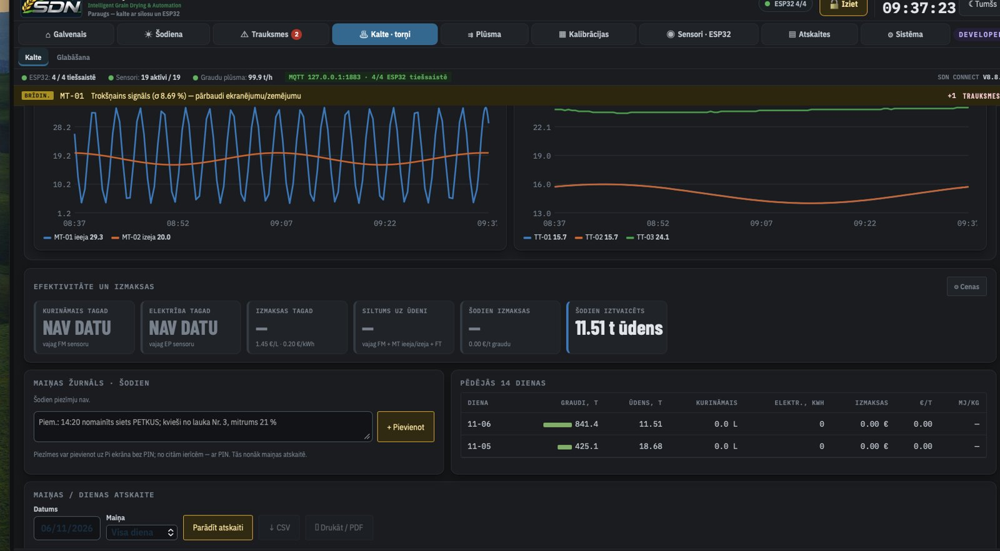 |

| Pi and node diagnostics | Office TV view with a critical alarm |
|---|---|
| 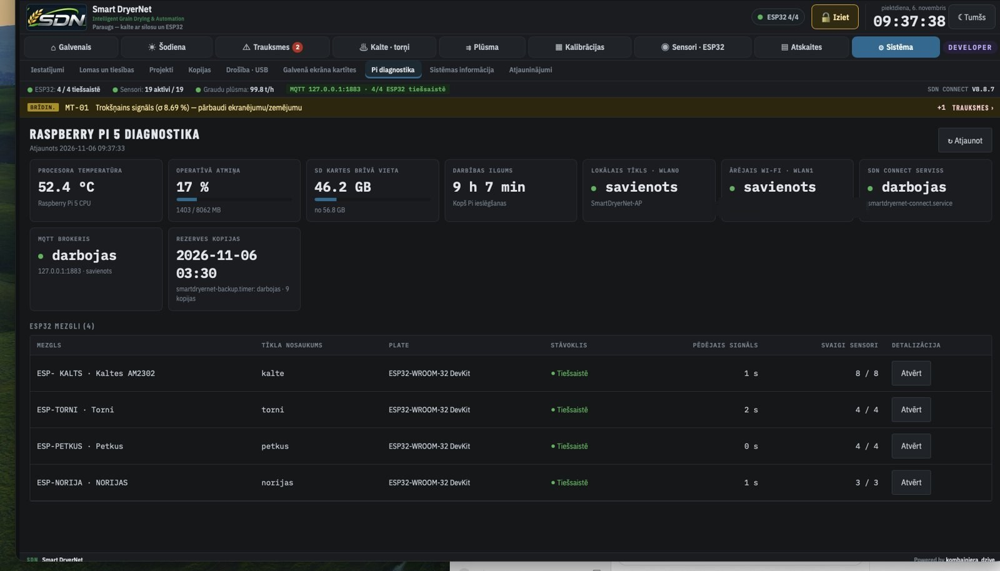 | 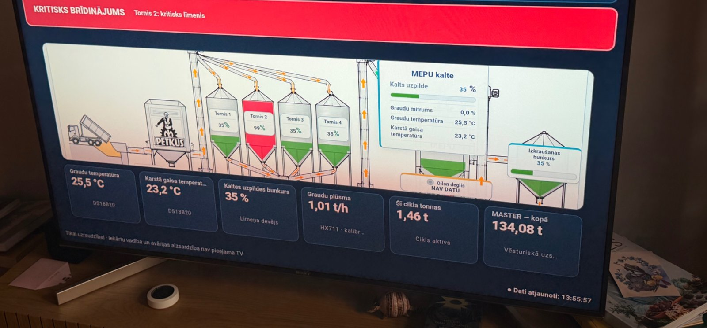 |

| SDN Dev — editor | SDN Dev — simulation |
|---|---|
| 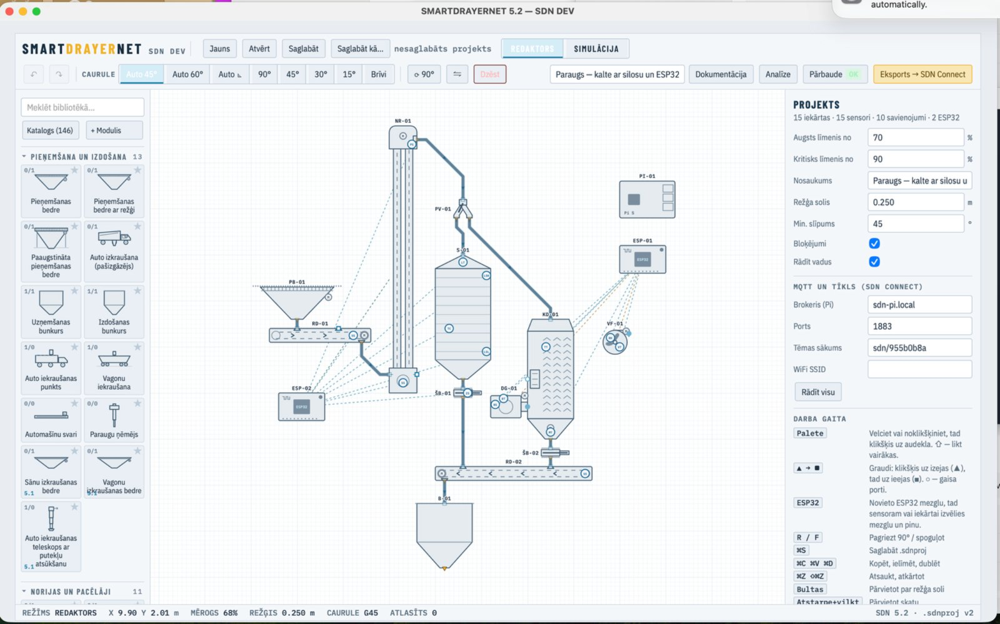 | 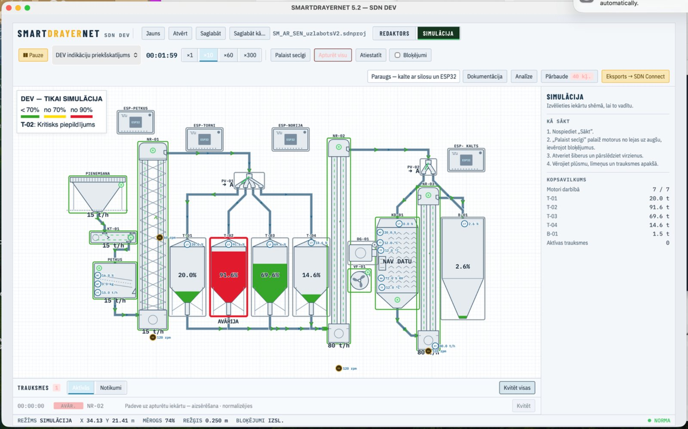 |

## Hardware

### Prototypes

| First ESP32 node | Early 7" display | Critical alarm | Elevator RPM board (in progress) |
|---|---|---|---|
| 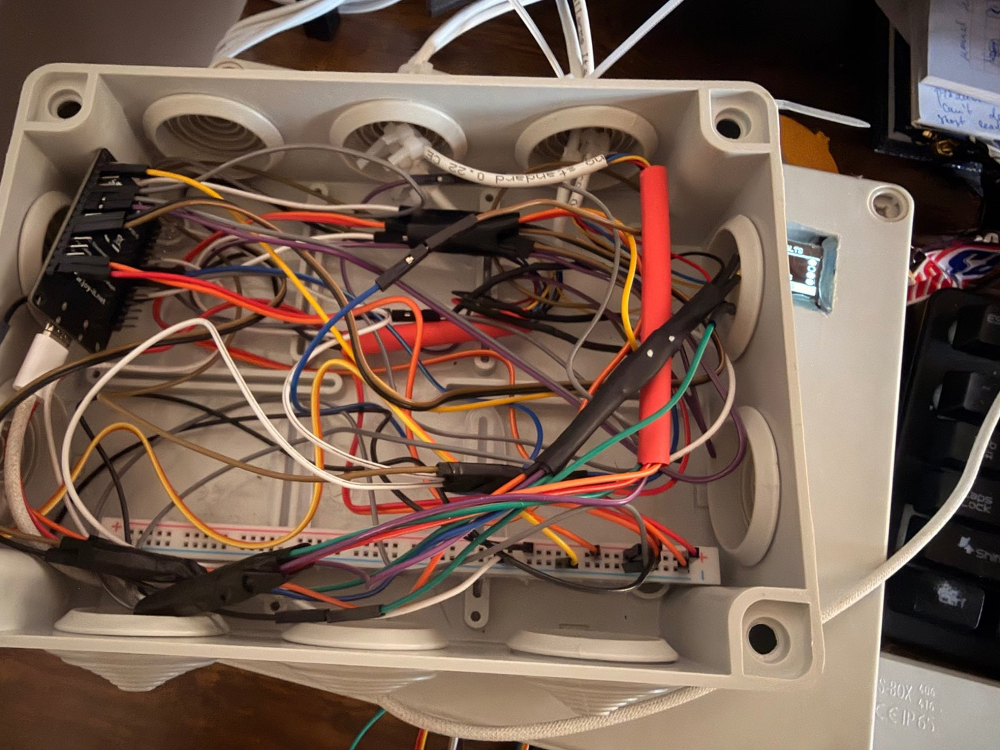 | 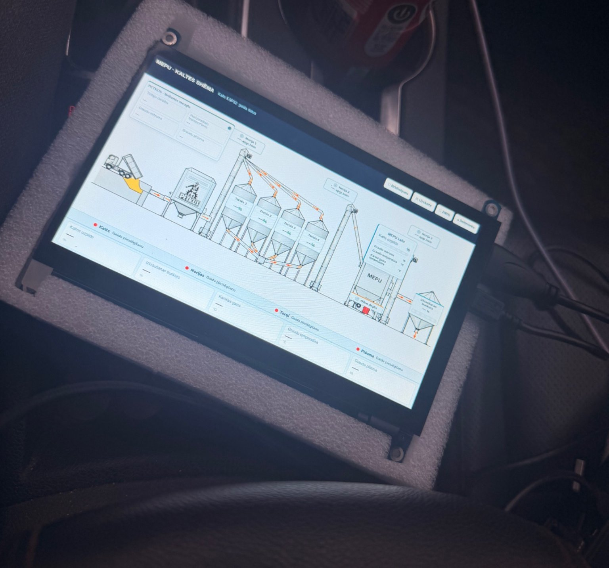 | 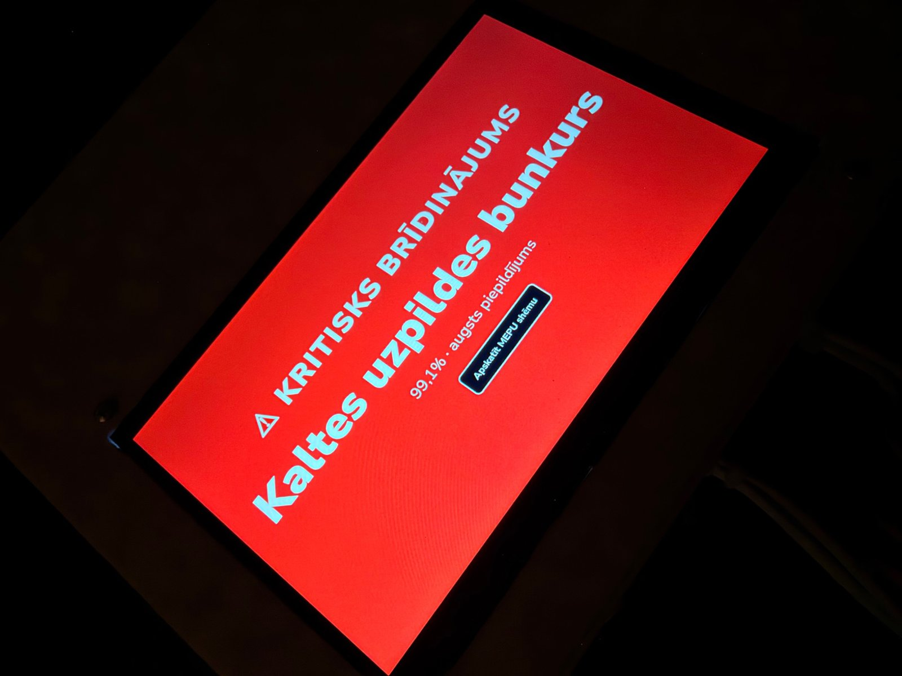 | 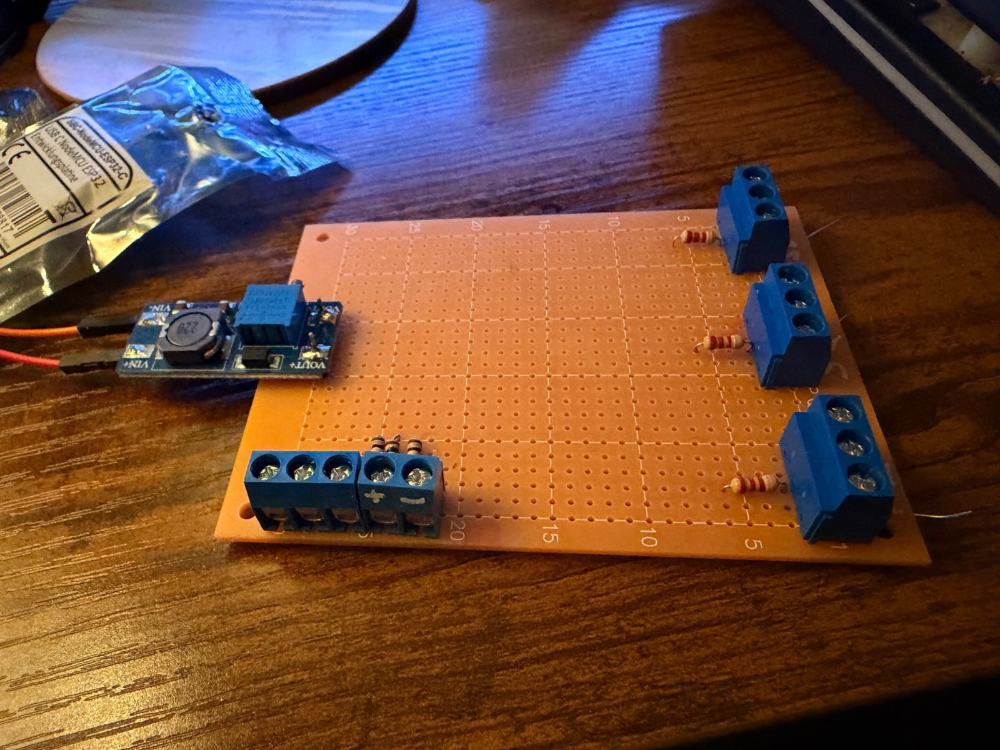 |

### Custom PCBs — V2 (designed, not yet manufactured)

A family of boards sharing the same building blocks: 12–24 V power with protection, ESP32 DevKit in sockets
with every pin broken out, RS485 / Modbus, and a status LED for every section.

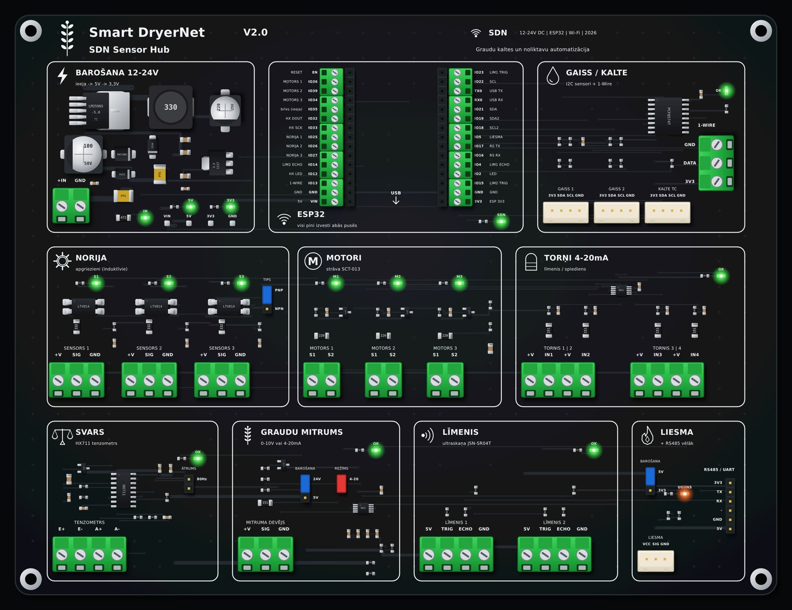

| Board | Size | Purpose |
|---|---|---|
| SDN Sensor Hub V2 | 210 × 160 mm | 3× elevator RPM, 3× motor current, 4× 4–20 mA, I²C air / dryer sensors, 1-Wire, load cell, moisture, 2× ultrasonic, flame |
| Elevator Node 3 / 5 | 176 × 120 mm | Speed (PNP/NPN, opto-isolated) + run status for 3 or 5 elevators |
| Tower Node | 176 × 120 mm | 3 towers: JSN-SR04T, 0–10 V or 4–20 mA level |
| Petkus Node | 176 × 168 mm | Grain moisture, vibration, flow load cell, RPM, run status, DS18B20 |
| Flow Node | 176 × 168 mm | 2× load cell, RPM, 2× analog inputs |
| Tower Node 20 | 230 × 184 mm | 20 towers, 4–20 mA / 0–10 V, 5× ADS1115 |
| Tower Node 20 JSN | 230 × 184 mm | 20 ultrasonic towers via buffers and multiplexers |

More renders: [docs/HARDWARE.md](docs/HARDWARE.md)

## Status

**Working now**
- SDN Connect 8.8.7 running on Raspberry Pi 5 with Touch Display 2
- 4 ESP32 nodes online (dryer, elevators, towers, Petkus cleaner)
- Plant designer and simulator (SDN Dev)
- First real sensors on the dryer node — other channels still run in test mode with simulated values until their sensors are installed

**In progress**
- Elevator RPM board (opto-isolated, 12 V inductive sensors)
- Replacing test channels with real sensors
- V2 PCBs: design check and first order

**Next**
- Field pilot on a working grain dryer
- 4G router with VPN remote access
- RS485 / Modbus devices
- Regular build-log updates

See [docs/ROADMAP.md](docs/ROADMAP.md).

## Tech stack

ESP32 (Arduino, MQTT, OTA) · Raspberry Pi 5 · Python · Mosquitto MQTT · HTML / CSS / JavaScript touch UI ·
KiCad · sensors: LJ12A3 inductive, AM2302 / SHT31, DS18B20, HX711, ADS1115, JSN-SR04T, SCT-013

## About this repository

This repository holds the public project documentation: overview, screenshots, photos and hardware renders.
The source code and board files are not public at the moment.

## Contact

Āris · Latvia · Instagram [@kombainiera_dzive](https://www.instagram.com/kombainiera_dzive/)
