# Software

Smart DryerNet has two programs that share one equipment and sensor library and one project file format (`.sdnproj`):

| | **SDN Dev** | **SDN Connect** |
|---|---|---|
| Runs on | macOS today, Windows planned | Raspberry Pi 5 + 10.1" Touch Display 2 at the dryer |
| Opened from | the same computer | the Pi panel or any browser on the local network — Windows, macOS, Linux, Android, iOS |
| Used by | the integrator / developer | operators, shift masters, the farm owner |
| Purpose | draw and simulate a plant, plan sensors and ESP32 nodes | run the plant view live from real sensors, alarms, calibration, reports |
| Output | a `.sdnproj` project file | live screens on the panel, office TV, phone and laptop |

A plant is drawn once in SDN Dev and copied to the Pi. Every farm has a different dryer and layout, so the project file is
what makes the same system fit a new site without changing code.

---

## SDN Dev — plant designer and simulator

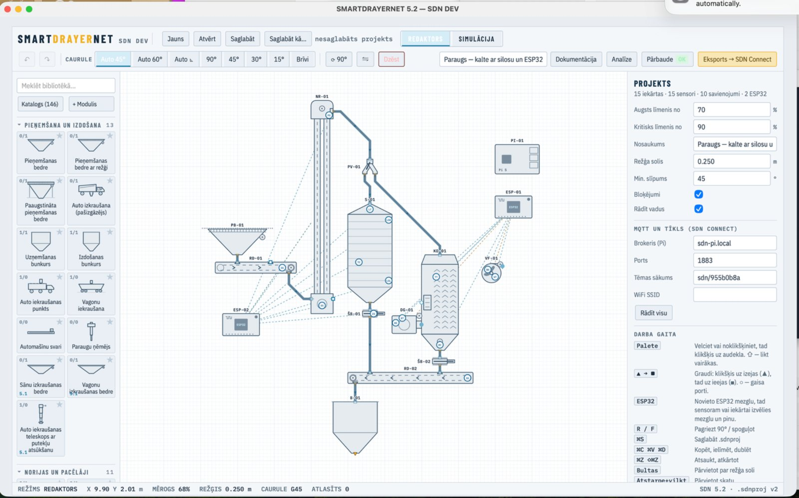

**Drawing the plant**
- Drag-and-drop editor with a grid, exact lengths and angles, and grain-flow lines that snap to equipment inlets and outlets
- Large part library in 11 groups: intake and loading, elevators, chain and belt conveyors / augers, dryers and heat,
  silos and bins, cleaning and grading, flow control (slide gates, diverters), scales and meters, ventilation and aspiration,
  processing and bagging, control and ESP32
- Every part has real parameters — capacity t/h, motor kW, nominal rpm, number of outlets, inlet/outlet positions,
  bin capacity and discharge rate, dryer set-point, fan and burner
- Equipment tags (NR-01, T-01, KD-01 …) follow the names used on site

**Sensors and ESP32 nodes**
- Sensors are placed at the exact point on the equipment where they will be mounted, each with a TAG (LT-01, TT-03, SS-01 …)
- ESP32 field nodes are part of the drawing: every sensor is wired to a node and a pin
- Pin conflicts and impossible combinations are checked (for example two sensors on one ADC channel)
- Supported interfaces include 4–20 mA / 0–10 V (ADS1115), PT100 (MAX31865), DS18B20, SHT31 / AM2302, HX711 load cells,
  JSN-SR04T ultrasonic, inductive RPM sensors, CO₂ (SCD40/41), current clamps
- A starting ESP32 configuration is generated from the drawing

**Simulation**

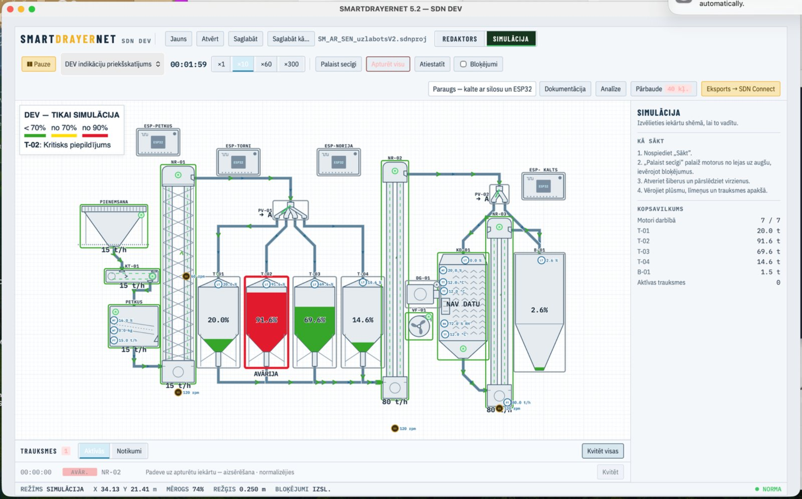

- Grain routes are animated through elevators, conveyors, diverters and gates
- Bins fill and empty according to capacities and flow; the dryer, fans and burner have run states
- Wrong routes (a closed gate, a full bin, a diverter set the other way) show up before anything is built

**Platforms**
- SDN Dev is a Python program with a web-based interface, so it is not tied to one operating system
- macOS today; a Windows launcher and a single-file Windows version are planned

**Export**
- One `.sdnproj` file holds the plant, the sensors, ESP32 bindings and calibration fields
- A project validator runs before export, so SDN Connect always receives a drawing it can display

---

## SDN Connect — the panel at the dryer

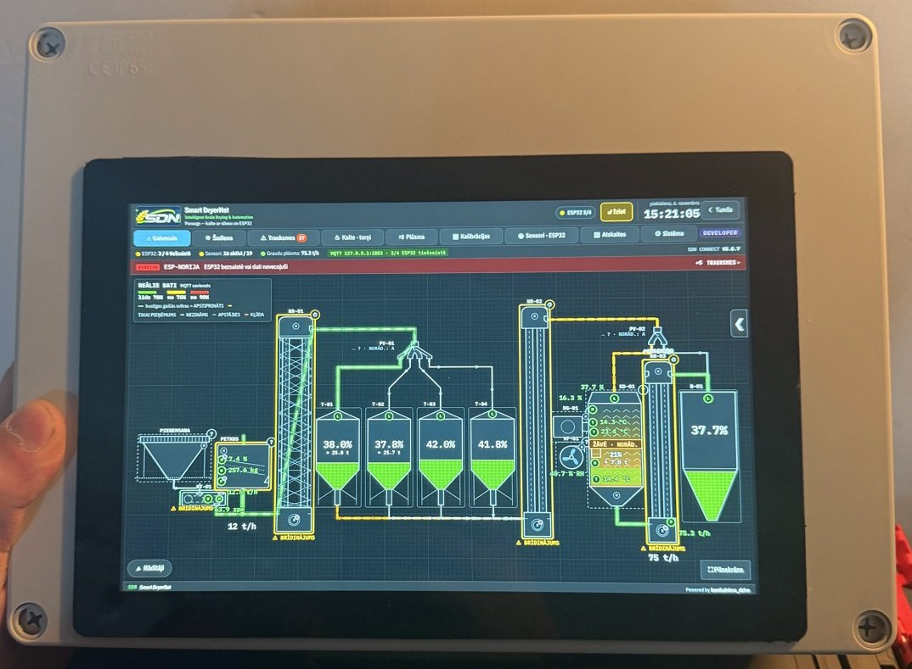

SDN Connect is a Python server with an MQTT broker on a Raspberry Pi 5. The touch UI runs in kiosk mode on the Pi screen
and the same pages open in any browser on the local network — office TV, phone, tablet, Windows or Mac computer.
Nothing has to be installed on those devices; what each person can see and change depends on their role and PIN.

**Main sections**

| Section | What it shows |
|---|---|
| **Main** | The live plant map: active routes in green with moving arrows, tower levels in % and tonnes, elevator rpm, flow t/h, dryer temperatures and humidity, warnings on each piece of equipment |
| **Today** | The day at a glance — tonnes, water removed and the main events |
| **Alarms** | Active and past alarms with time, value and acknowledgement |
| **Dryer · towers** | Dryer mode, air and grain temperatures; every tower with fill level, tonnes and trend |
| **Flow** | Grain flow in t/h and totals |
| **Calibration** | The calibration centre (below) |
| **Sensors · ESP32** | Every sensor with value, RAW value and age of data; every ESP32 node with Wi-Fi signal, uptime, restarts, firmware and IP address |
| **Reports** | Dryer and shift reports, 14-day history, CSV / PDF export |
| **System** | Pi health, backups, updates, settings |

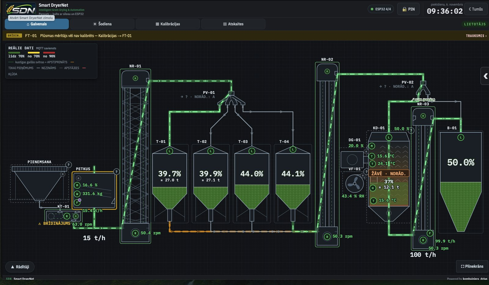

**Real data only**
- Grain-flow animation runs only when fresh sensor data confirms the equipment is running; an operator-selected route
  without confirmation is shown, but not animated
- A sensor without fresh data shows *NO DATA*, an ESP32 that drops off the network raises an *offline* warning
- Test and demo values are always labelled as such and never mixed with real data

**Flow monitoring — every connection is checked**

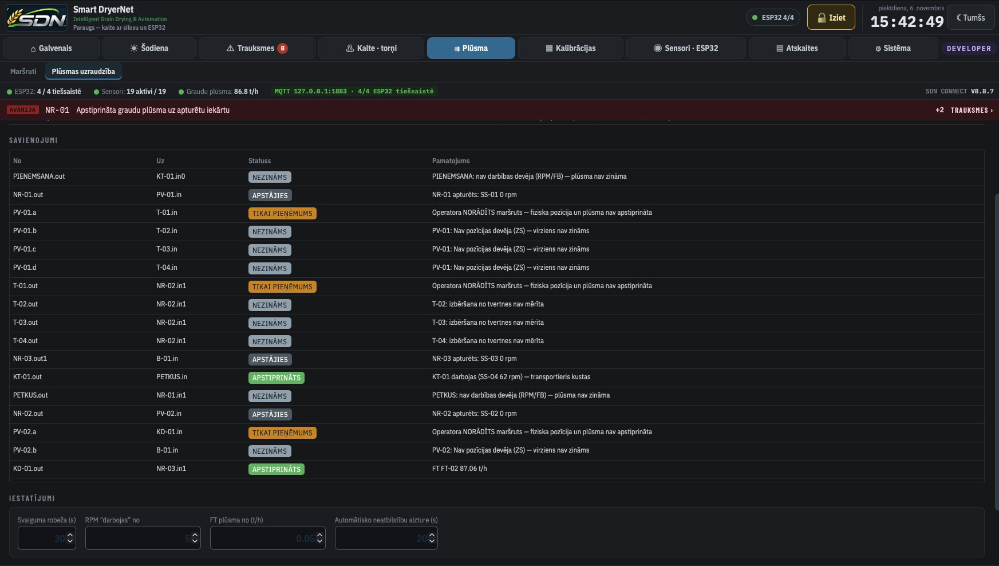

Every grain connection on the map has its own status with the reason behind it:
**CONFIRMED** (for example *KT-01 running, SS-04 62 rpm — conveyor moving*), **STOPPED** (*NR-01 stopped: SS-01 0 rpm*),
**OPERATOR ONLY** (a route the operator selected but no sensor confirms yet) and **UNKNOWN** (no run sensor or gate position sensor).
A confirmed flow into a stopped machine raises a critical alarm. Freshness limits, the rpm and t/h thresholds and the alarm
delay are set on the same page.

**Calibration centre**

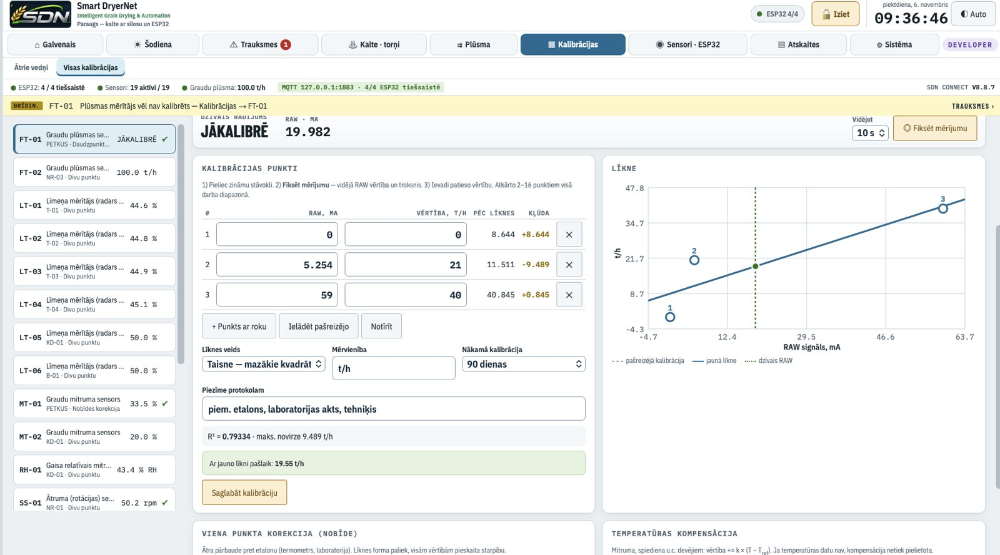

- 2–16 point calibration curves for any analog sensor, with a live graph of old curve, new curve and the current RAW value
- *Capture* averages a reading over 5–60 s and shows noise and drift, so a point is only saved when the reading is stable
- One-point offset against a reference instrument and temperature compensation
- Grain moisture curves per crop (wheat, barley, oats, rapeseed, hemp …) from lab samples, with R² and maximum error
- Flow calibration with a weighing test: run the line, enter the weighed tonnes, the system calculates the correction
- Bins and towers: round or square, cone bottom and grain cone on top, a live cross-section drawing and real bulk density
  from a known tonnage
- A sensor catalogue of real ESP32 sensor variants with wiring and starting calibration
- Every calibration is logged with time, method, values before and after — exportable to CSV

**Drying advisor**

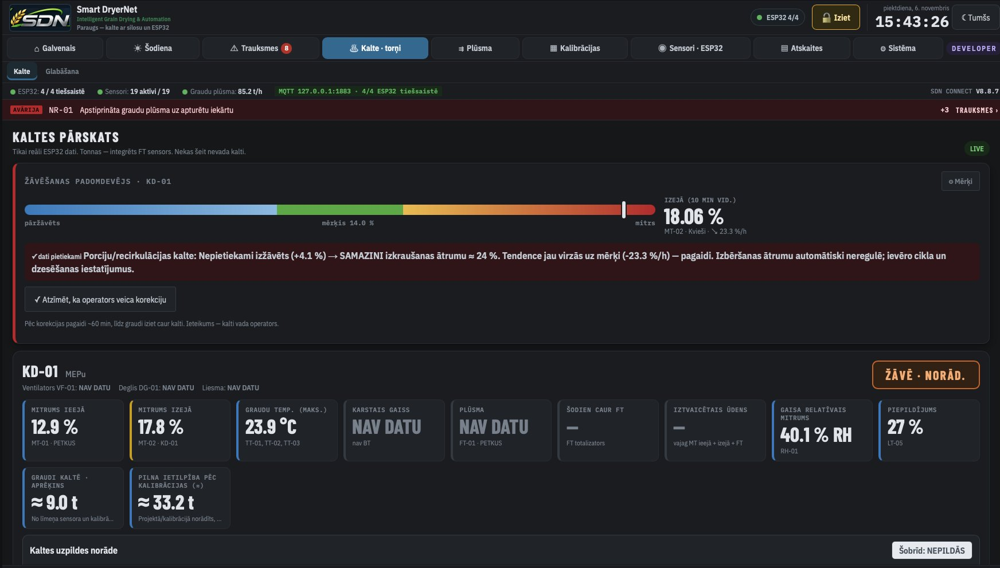

The dryer page shows inlet and outlet moisture, grain and air temperatures, humidity, fill level and estimated tonnes in the dryer.
The drying advisor compares the 10-minute average outlet moisture with the target for the selected crop, looks at the trend
and suggests what the operator should change — for example *reduce the discharge speed by about 24 %*, or *wait, the trend is
already moving towards the target*. The operator marks when a correction was made. The advisor never changes anything itself.

**Roles and permissions**

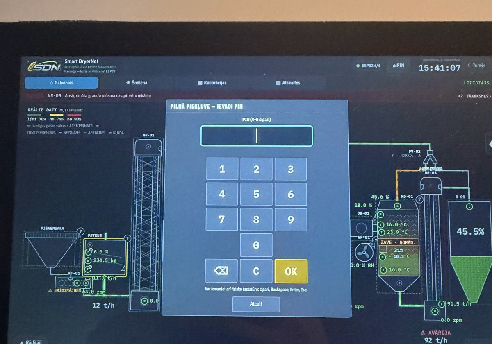

| Role | PIN | Access |
|---|---|---|
| **User** | none | what the developer allows — by default the plant map, alarms and route selection |
| **Master** | own PIN | what the developer allows — for example calibration and reports |
| **Developer** | developer PIN | everything, including the permissions editor |

- Permissions are set per section, per action, per piece of equipment and per sensor (value / RAW / calibration / history)
- Rights are checked on the server for every request — a hidden button is not the only protection
- Critical alarms are always shown, even when a value is hidden from a role
- *Preview as User / Master* shows exactly what that role will see
- Every change of PIN or permissions is written to an audit log

**Incident replay**

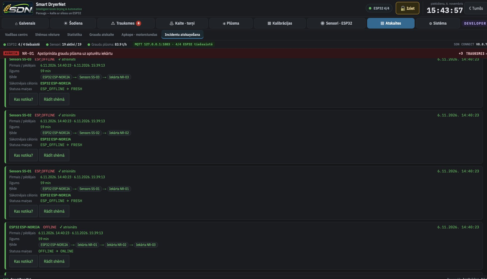

Every incident is kept with its whole chain — for example *ESP32 ESP-NORIJA → sensor SS-01 → elevator NR-01* — the root cause,
first and last time, duration and every status change. *What happened?* explains it in plain words and *Show on map* replays it
on the plant drawing.

**Reports and screens**

| Dryer and shift report | Office TV (read-only) |
|---|---|
| 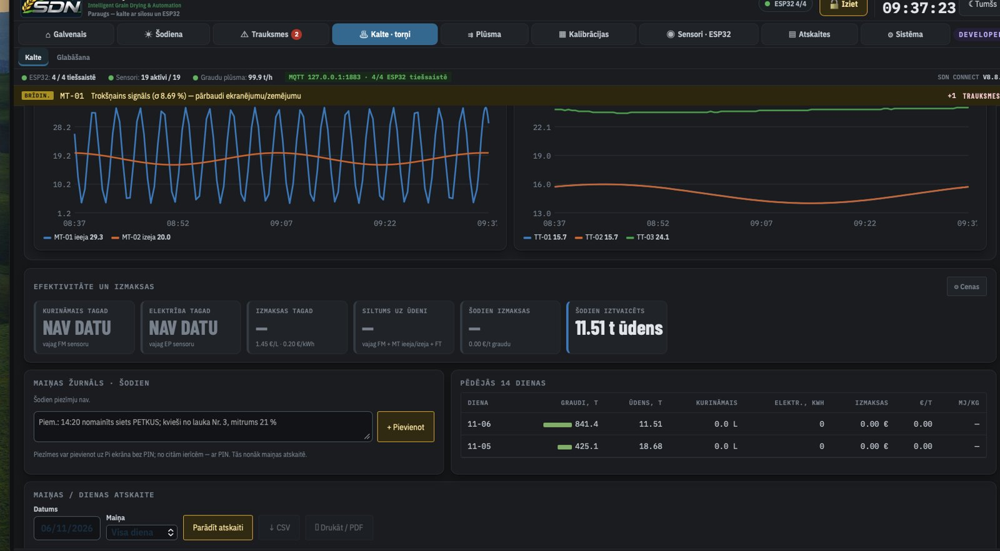 | 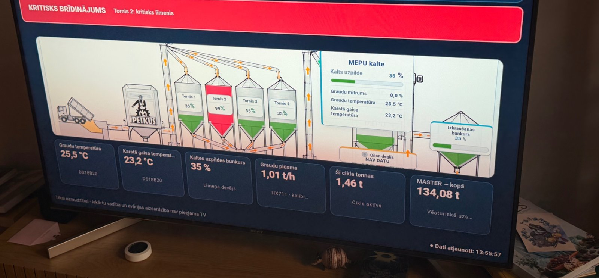 |

**Safety and reliability**
- **Monitoring only** — no button in SDN Connect switches motors, gates or burners, and permissions cannot enable it
- Atomic saves with a backup of the previous project version; nightly backups of program, data and projects
- Updates install in two steps: a test copy on a separate port first, then *apply* — if the new version does not answer
  within 45 s, the previous one is restored automatically
- Starts by itself when the Pi powers on and runs fully offline on the local network

**ESP32 nodes**
- Arduino firmware for every node type, one `config.h` per node (Wi-Fi, MQTT, name, board type, channel table)
- MQTT topics per node and sensor TAG — after binding a node in SDN Connect, values appear in the right place on the map
- Over-the-air updates, status LED, test mode with clearly marked simulated values for commissioning
- Inductive RPM through PC817 optocouplers, ultrasonic level, 4–20 mA / 0–10 V, temperature and humidity, load cells, current

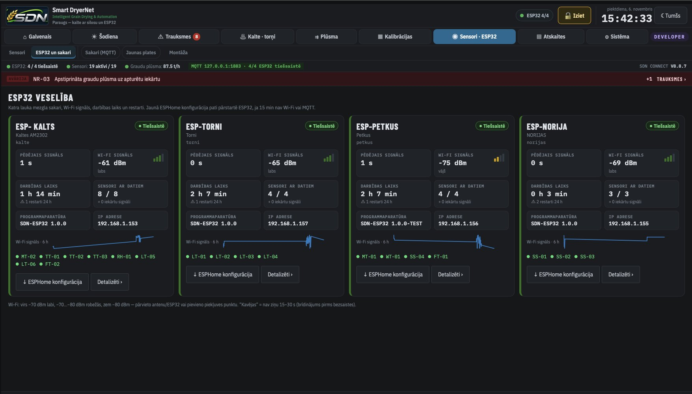

The ESP32 health page shows for every node: last message, Wi-Fi signal with a 6-hour graph, uptime and restarts in 24 h,
sensors with data, firmware version, IP address and which sensor tags it serves.
